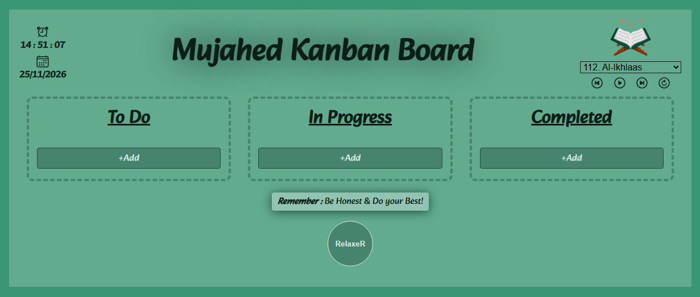
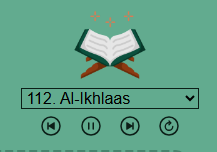
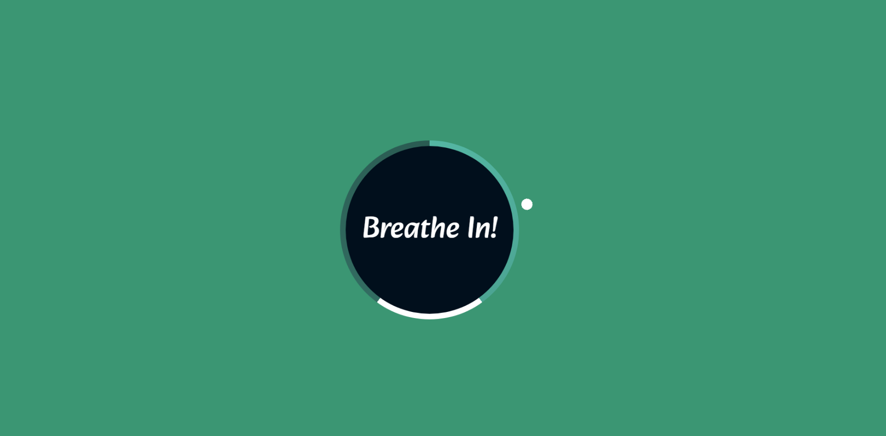
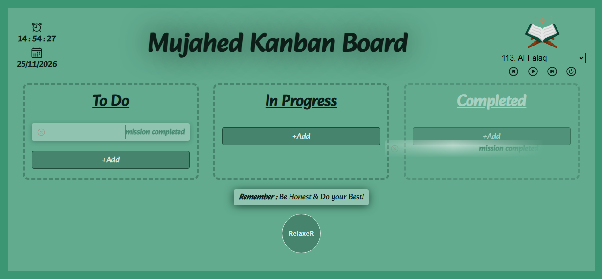
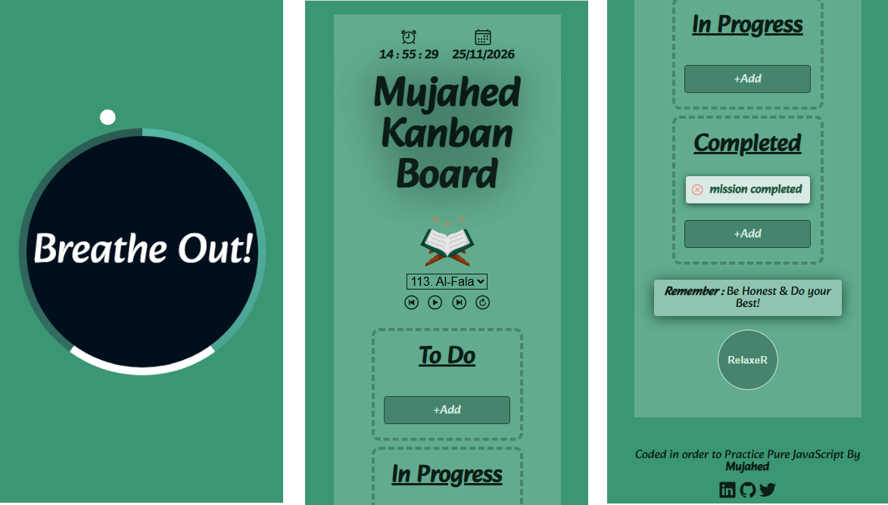

<div align="center">

# 🗂️ Mujahed Kanban Board

**A Kanban productivity board with a Quran player and a guided breathing relaxer — built with pure HTML, CSS, and vanilla JavaScript.**

[](https://mujKanbanBoard.netlify.app/)
[](https://developer.mozilla.org/en-US/docs/Web/HTML)
[](https://developer.mozilla.org/en-US/docs/Web/CSS)
[](https://developer.mozilla.org/en-US/docs/Web/JavaScript)
[](./LICENSE)

</div>

---

## 📖 Table of Contents

- [Overview](#-overview)
- [Screenshots](#-screenshots)
- [Features](#-features)
- [Tech Stack](#-tech-stack)
- [Getting Started](#-getting-started)
- [How It Works](#-how-it-works)
- [Accessibility](#-accessibility)
- [Project Structure](#-project-structure)
- [Roadmap](#-roadmap)
- [Contributing](#-contributing)
- [Author](#-author)
- [License](#-license)

---

## 🌟 Overview

**Mujahed Kanban Board** is a single-page productivity app that combines three ideas in one place:

1. A classic **Kanban board** (To Do / In Progress / Completed) with drag-and-drop.
2. A **Quran player** streaming Mishary Alafasy recitation via the public [alquran.cloud](https://alquran.cloud) API.
3. A **breathing relaxer** built with pure CSS animations to help you reset between tasks.

Everything is saved to `localStorage` — no backend, no account, no tracking. Open the page and start working.

---

## 📸 Screenshots

<div align="center">

### Desktop — Kanban Board



### Quran Player



### Breathing Relaxer



### Drag & Drop Between Lists



### Responsive Layout



</div>

---

## ✨ Features

### Core

- ✅ **Add / Edit / Delete tasks** — click _+Add_, type inline (`contenteditable`), delete with the icon or `Backspace` on empty.
- ✅ **Drag & drop** tasks between _To Do_, _In Progress_, and _Completed_.
- ✅ **Persistent order** — every task is stored with an explicit `order` field so the board looks identical after reload.
- ✅ **Autosave** to `localStorage` (debounced during typing to avoid jank).

### Extras

- 🕌 **Full Quran player** — all 114 surahs, ayah-by-ayah playback via the alquran.cloud REST API.
  - Resume from the exact ayah you stopped on — even after a page reload (always restarts from the _beginning_ of that ayah).
  - Auto-advance to the next surah after the last ayah.
  - `Restart` button to replay the current surah from the first ayah.
- 🌬️ **Breathing relaxer** — a 7.5s In/Hold/Out cycle driven entirely by CSS animations and `setTimeout`.
- 🕐 **Live clock & date** — updates every second.
- ⌨️ **Keyboard-first** — full navigation via `Tab`, `Enter`/`Space`, and `Escape`.

---

## 🛠️ Tech Stack

| Layer   | Technology                                                               |
| ------- | ------------------------------------------------------------------------ |
| Markup  | HTML5 (semantic)                                                         |
| Styling | CSS3 — custom properties, flexbox, `conic-gradient`, keyframe animations |
| Logic   | Vanilla JavaScript (ES2020) — modules, async/await, drag-and-drop API    |
| Audio   | HTML5 `<audio>` + [alquran.cloud](https://alquran.cloud) REST API        |
| Icons   | [Ionicons 7](https://ionic.io/ionicons)                                  |
| Font    | [Alkatra](https://fonts.google.com/specimen/Alkatra) (Google Fonts)      |
| Storage | `localStorage`                                                           |

**No frameworks, no bundler, no build step.** Just three files.

---

## 🚀 Getting Started

### Option 1 — Live demo

👉 **<https://mujKanbanBoard.netlify.app/>**

### Option 2 — Run locally

```bash
git clone https://github.com/MucahidDeveloper/MyKanbanBoard.git
cd MyKanbanBoard
```

Because the app fetches from `https://api.alquran.cloud`, some browsers block `file://` requests. Serve it locally:

```bash
# Python
python -m http.server 8000

# Node
npx serve .

# VS Code
# → Right-click index.html → "Open with Live Server"
```

Then open <http://localhost:8000>.

---

## ⚙️ How It Works

### Data model

Each task is a small object stored as part of its column's array:

```json
{ "id": "42.13579", "value": "Write the README", "order": 0 }
```

`localStorage` keys:

| Key           | Value                                      |
| ------------- | ------------------------------------------ |
| `listNew`     | array of To Do tasks                       |
| `listWorking` | array of In Progress tasks                 |
| `listFinish`  | array of Completed tasks                   |
| `surahNumber` | current surah (1–114)                      |
| `ayahIndex`   | current ayah index in that surah (0-based) |

### Quran player state machine

The player uses an integer **token** to cancel stale playback sessions:

- Every `play()` / `next()` / `prev()` / `restart()` / surah change increments `token`.
- The playback loop compares `myToken` against the live `token` after every `await` and bails out if it changed.
- `audio.currentTime` is reset to `0` before each ayah — for _adab_, we never resume mid-verse.

### Order preservation

On every drop and every write, the column's DOM is snapshotted into an array and each item is given a fresh `order` equal to its index. On reload, arrays are sorted by `order`, so the visual layout is deterministic.

---

## ♿ Accessibility

- ARIA roles and labels on all interactive icons (`role="button`", `aria-label`, `aria-pressed`, `aria-haspopup`).
- Full keyboard support:
  - `Tab` / `Shift+Tab` to navigate.
  - `Enter` / `Space` to activate buttons.
  - `Escape` to close the relaxer dialog.
  - `Delete` / `Backspace` on an empty task to remove it.
- Relaxer is announced as `role="dialog" aria-modal="true`" with `aria-live="polite`" on the changing prompt.
- Decorative icons and shapes marked `aria-hidden="true`".

---

## 📁 Project Structure

```text
MyKanbanBoard/
├── index.html
├── script.js
├── style/
│   ├── style.css          # global styles, colors, layout
│   ├── listContent.css    # task cards, drag states
│   ├── relaxer.css        # breathing circle & modal
│   └── media.css          # responsive breakpoints
├── img/
│   ├── favicon.png
│   └── Qimg.png
└── docs/
    └── screenshots/
        ├── desktop.png
        ├── quran-player.png
        ├── relaxer.png
        ├── drag-and-drop.png
        └── responsive.png
```

---

## 🗺️ Roadmap

Planned enhancements — issues and PRs welcome:

- [ ] **Configurable breathing time** — let the user set the cycle duration.
- [ ] **Motivational quote rotation** — replace the static "Remember" card with a rotating array.
- [ ] **Manual reordering** — up/down buttons as an accessible alternative to drag-and-drop.
- [ ] **Quran reciter selector** — pick from multiple `ar.*` editions on alquran.cloud.
- [ ] **Speech-to-text task editing** — Browser Speech Recognition API.
- [ ] **Undo/redo** — 5-second undo for delete and move actions.
- [ ] **Light/dark theme** — CSS `prefers-color-scheme` support.
- [ ] **Full offline mode** — service worker + cached audio.

---

## 🤝 Contributing

1. Fork the repository.
2. Create a feature branch: `git checkout -b feat/your-feature`.
3. Follow [Conventional Commits](https://www.conventionalcommits.org/) (`feat:`, `fix:`, `refactor:`, `docs:`).
4. Keep PRs small and focused — one logical change per PR.
5. Open a Pull Request with a clear description and screenshot if UI changes.

Bug reports and feature suggestions are welcome in [Issues](https://github.com/MucahidDeveloper/MyKanbanBoard/issues).

---

## 👤 Author

**Mujahed**

- LinkedIn: [@mucahid-developer](https://www.linkedin.com/in/mucahid-developer/)
- GitHub: [@MucahidDeveloper](https://github.com/MucahidDeveloper)
- Twitter: [@MujDeveloper](https://twitter.com/MujDeveloper)

---

## 📄 License

Released under the [MIT License](./LICENSE).

---

<div align="center">

**Built with 💚 while learning pure JavaScript.**

If this project helped or inspired you, a ⭐ on the repo means a lot.

</div>
